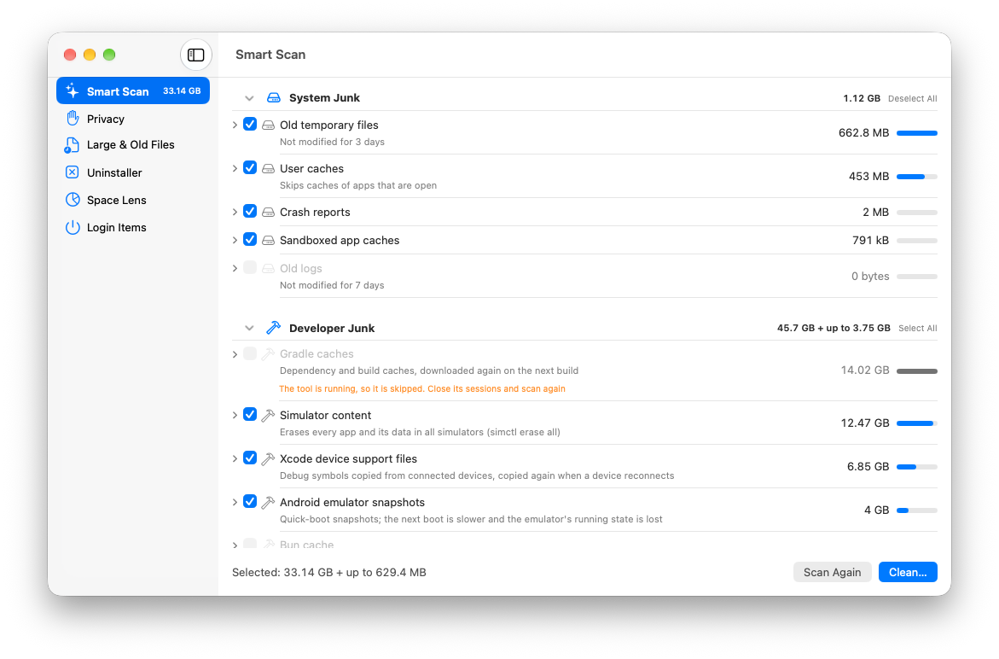

# CleanMate

A native macOS app that frees disk space and clears privacy traces — fast, simple and careful.

<picture>
  <source media="(prefers-color-scheme: dark)" srcset="docs/images/1-smart-scan-dark.png">
  
</picture>

Everything is previewed first and only removed after you confirm. CleanMate runs entirely on your Mac:
no account, no telemetry; its only network connection is the update check, which you can turn off.

> CleanMate is an independent open-source project, not affiliated with MacPaw or CleanMyMac.

## Features

- **Smart Scan** — system junk, developer junk (Xcode, simulators, package caches, Docker, Homebrew…), AI tool data
  and app caches in one scan, using each tool's own cleanup command when it is installed.
- **Privacy** — browsing history, download history, cookies and autofill per browser, plus recent items, QuickLook
  thumbnails and shell history. Nothing is ticked by default.
- **Large & Old Files** — find big or unused files in your home folder or a folder you pick, including duplicates.
- **Uninstaller** — remove apps together with their data, reset an app, find leftovers, unknown hidden config and
  extensions.
- **Space Lens** — browse any folder sorted by size, with a donut chart of its contents.
- **Login Items** — disable, enable or remove your launch agents.

Undo (⌘Z) puts back what a module just moved to the Trash, and an activity log records every removal.
See **[docs/FEATURES.md](docs/FEATURES.md)** for every module, setting and shortcut in detail.

## Install

1. Download the latest `CleanMate-<version>.dmg` from
   [GitHub Releases](https://github.com/homielab/cleanmate/releases/latest).
   It is signed with a Developer ID and notarized by Apple; a `.sha256` checksum is published next to it.
2. Open the disk image and drag **CleanMate** to **Applications**.
3. Later versions install from the app: **CleanMate › Check for Updates…**. On the second launch CleanMate asks
   whether to check automatically; change it any time in Settings › General › Updates.

Homebrew (coming soon, once the tap is published): `brew install --cask homielab/tap/cleanmate`.
The cask is in `packaging/Casks/cleanmate.rb`.

Requires **macOS 13** or later.

## Safety

- **Preview, then confirm.** Nothing is removed until you confirm what was listed.
- **Trash vs delete.** Regenerable data (caches, logs, developer junk) and privacy traces are deleted; user files,
  apps, app data and launch agents go to the Trash, so you can put them back.
- **Hard blocklist**, checked when scanning and again right before every removal: only your home and temporary
  folder, never keys and sign-ins (`.ssh`, `.gnupg`, Keychains), your documents, iCloud Drive, Mail or Messages,
  passwords, bookmarks or settings.
- **Running apps are skipped**, and so are files another process has open.
- **Exclusions**: folders and files you exclude are never listed or removed.
- **Only your user account**: no administrator rights, no privileged helper, no system files.

The full rules are in [docs/FEATURES.md › Safety](docs/FEATURES.md#safety).

## Privacy

CleanMate collects no data: no analytics, no telemetry. Its only network connection is the update check
([Sparkle](https://sparkle-project.org)): it downloads the update feed from this repository's GitHub Releases, and a
new version only when you install it or turn on automatic downloads. Nothing about you or your Mac is sent (system
profiling is off). Automatic checks are off until you answer the question on the second launch, and can be turned
off in Settings › General › Updates. Updates are signed (EdDSA) and verified before they are installed.
Settings stay in the app's own preferences on your Mac.

## Permissions

- **Full Disk Access** is optional. It is needed to read the Trash, Safari data and some app containers. CleanMate
  offers it once at first launch; you can grant it later in System Settings › Privacy & Security › Full Disk Access.
  Without it, folders macOS protects are skipped and you are told so.
- **App Sandbox is off**: a cleaner must read and remove caches of other apps and developer tools across your home
  folder, which a sandboxed app cannot do. Hardened Runtime is on, and CleanMate is distributed outside the Mac App
  Store (Developer ID, notarized).

## Languages

English (default) and Vietnamese, following your system language. To pick a language for CleanMate only:
System Settings › General › Language & Region › Applications.

## Build from source

Requires Xcode 27. The only third-party dependency is [Sparkle](https://sparkle-project.org) for
updates, fetched by Swift Package Manager on the first build. Tests and the smoke test never check for updates.

```sh
# Build
xcodebuild -project CleanMate/CleanMate.xcodeproj -scheme CleanMate -destination 'platform=macOS' build

# Tests (Swift Testing; they only use temporary folders, never your real files)
xcodebuild -project CleanMate/CleanMate.xcodeproj -scheme CleanMate -destination 'platform=macOS' test

# Launch smoke test of the real app (prints PASS/FAIL; never scans or cleans)
scripts/smoke.sh

# Compiler warnings in Debug and Release
scripts/check-warnings.sh
```

Or open `CleanMate/CleanMate.xcodeproj` in Xcode and press Run.
`scripts/release.sh --help` explains how to build a signed, notarized DMG and the `appcast.xml` update feed; their
release notes come from the version's section in [CHANGELOG.md](CHANGELOG.md).

## Project layout

- `CleanMate/CleanMate/Engine/` — scanning, cleaning and safety rules (`SafetyPolicy`), declarative catalogs
  (`SmartScanCatalog`, `DeveloperCatalog`, `AppCatalog`, `PrivacyCatalog`), `ActivityLog`, `Preferences`.
- `CleanMate/CleanMate/Views/` — one view and model per module, plus Settings.
- `CleanMate/CleanMate/AppIcon.icon` — the app icon (open it in Icon Composer).
- `CleanMate/Info.plist` — Sparkle settings merged into the generated Info.plist: update feed URL and public EdDSA key.
- `CleanMate/CleanMateTests/` — unit and end-to-end tests.
- `scripts/` — smoke test, warning check, snapshot diff and release script.
- `docs/` — detailed features and the README screenshots.

## Contributing

Bug reports, ideas and pull requests are welcome.

- **Issues**: describe what you expected, what happened, and your macOS version. For a cleaning problem, the matching
  lines of `~/Library/Logs/CleanMate/activity.log` help.
- **Pull requests**: keep them focused, and run the build and tests above before opening one.
- **Strings**: every new user-facing string in `Localizable.xcstrings` needs a Vietnamese (`vi`) translation — a test
  checks this.
- **New cleaning items**: declare them in a catalog, and make sure every path they remove passes `SafetyPolicy`. Opening
  a blocked area means changing `SafetyPolicy` on purpose, with tests for it.
- User-visible changes go in [CHANGELOG.md](CHANGELOG.md) under **Unreleased**; new or changed features also go in
  [docs/FEATURES.md](docs/FEATURES.md).

## Support

CleanMate is free and open source. If it saved you time or disk space, you can support its development on
[Ko-fi](https://ko-fi.com/homielab).

## License

CleanMate is released under the [MIT License](LICENSE). Copyright © 2026 HomieLab.
