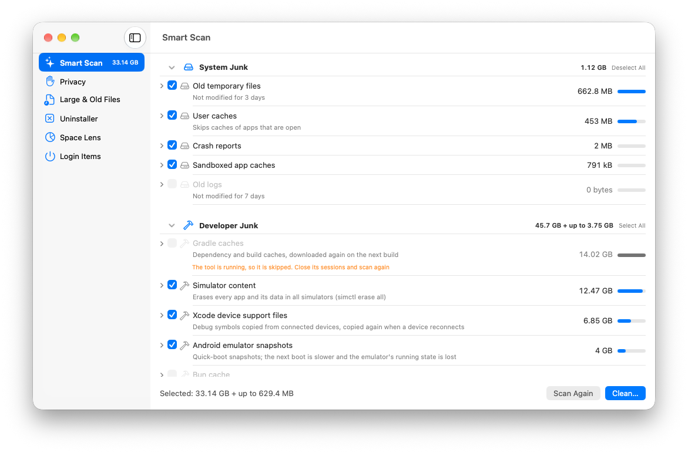

# CleanMate

[][releases] [](LICENSE) [](#install)

CleanMate is a free, open-source (MIT) cleaner for your Mac: it frees disk space and clears privacy traces —
system junk, developer junk (Xcode, Docker, Homebrew…), downloaded AI models and AI tool data, apps with
their leftovers — and shows what fills your disk. Everything is previewed first and only removed after you
confirm. It runs entirely on your Mac: no account, no telemetry; its only network connection is the update
check, which you can turn off.

[**Website**](https://cleanmate.homielab.com) · [**Download CleanMate-1.7.dmg**](https://github.com/homielab/cleanmate-macos/releases/latest/download/CleanMate-1.7.dmg) · [All releases][releases] · [Ubuntu version](https://github.com/homielab/cleanmate-linux)

<picture>
  <source media="(prefers-color-scheme: dark)" srcset="docs/images/1-smart-scan-dark.png">
  
</picture>

## Install

1. Download [CleanMate-1.7.dmg](https://github.com/homielab/cleanmate-macos/releases/latest/download/CleanMate-1.7.dmg)
   (verify the [`.sha256` checksum](https://github.com/homielab/cleanmate-macos/releases/latest/download/CleanMate-1.7.dmg.sha256)) —
   signed with a Developer ID and notarized by Apple. Open the disk image and drag **CleanMate** to **Applications**.
   Requires **macOS 13** or later. Later versions install from the app: **CleanMate › Check for Updates…**
   (offered at the second launch; off until then — Settings › General › Updates).
2. The `cleanmate` command line for scripts and AI agents (Claude Code, Codex…) is inside the app
   (`/Applications/CleanMate.app/Contents/Helpers/cleanmate`). Put it on your `PATH`:

```sh
mkdir -p ~/.local/bin
ln -s /Applications/CleanMate.app/Contents/Helpers/cleanmate ~/.local/bin/cleanmate
cleanmate --help
```

When the Homebrew tap is published, `brew install --cask homielab/tap/cleanmate` will install the app and
link `cleanmate` for you (planned; the cask lives in `packaging/Casks/cleanmate.rb`).

Everything the command does — `list`, `scan`, `clean`, `space`, `large`, `dupes`, `trash`, `restore`, `--json`,
Full Disk Access — and installing it for [AI agents](https://agentskills.io) (`bunx skills add homielab/cleanmate-macos`):
[docs/FEATURES.md › Command line](docs/FEATURES.md#command-line).

> CleanMate is an independent open-source project, not affiliated with MacPaw or CleanMyMac.

## Features

- **Overview** — free space on each drive, what CleanMate freed, and the largest folders in your home.
- **Smart Scan** — system junk, developer junk (Xcode, simulators, package caches, Docker, Homebrew…), AI tool data
  and app caches in one scan, using each tool's own cleanup command when it is installed.
- **Privacy** — browsing history, download history, cookies and autofill per browser, plus recent items, QuickLook
  thumbnails and shell history. Nothing is ticked by default.
- **Large & Old Files** — find big or unused files in your home folder or a folder you pick, including duplicates.
- **Uninstaller** — remove apps together with their data, reset an app, find leftovers, unknown hidden config and
  extensions.
- **Space Lens** — browse any folder sorted by size, with a donut chart of its contents.
- **Login Items** — disable, enable or remove your launch agents.
- **Maintenance** — rebuild Launch Services (duplicate "Open With" apps), reset Quick Look, restart Finder and Dock, reset the
  font and icon caches; no administrator password.

Undo (⌘Z) puts back what a module just moved to the Trash, and an activity log records every removal.
See **[docs/FEATURES.md](docs/FEATURES.md)** for every module, setting and shortcut in detail.

## How it compares

| | CleanMate | CleanMyMac | OnyX | BleachBit |
|---|---|---|---|---|
| Price | Free | Paid subscription | Free (freeware) | Free |
| License | MIT, open source | Proprietary | Proprietary | GPL-3.0, open source |
| Platforms | macOS 13+, Ubuntu (separate app) | macOS | macOS | Linux, Windows; macOS experimental |
| Command line for cleaning | In the app | Separately (CleanMyMac CLI) | — | yes |
| Uninstall apps with their leftovers | yes | yes | yes | no |

Checked against each app's own website and documentation (November 2026); "—" = its site lists no command line.
More comparisons and sources: [cleanmate.homielab.com/compare](https://cleanmate.homielab.com/compare/).

## Safety

- **Preview, then confirm.** Nothing is removed until you confirm what was listed.
- **Trash vs delete.** Regenerable data (caches, logs, developer junk) and privacy traces are deleted; user files,
  apps, app data and launch agents go to the Trash, so you can put them back.
- **Hard blocklist**, checked when scanning and again right before every removal: only your home and temporary
  folder, never keys and sign-ins (`.ssh`, `.gnupg`, Keychains), your documents, iCloud Drive, Mail or Messages,
  passwords, bookmarks or settings.
- **No symlink tricks**: each item is checked and deleted inside the same open folder, so a symlink swapped in
  after the scan can't redirect a removal.
- **Running apps are skipped**, and so are files another process has open.
- **Exclusions**: folders and files you exclude are never listed or removed.
- **Only your user account**: no administrator rights, no privileged helper, no system files.

The full rules are in [docs/FEATURES.md › Safety](docs/FEATURES.md#safety).

## Privacy

CleanMate collects no data: no analytics, no telemetry. Its only network connection is the update check
([Sparkle](https://sparkle-project.org)): it downloads the update feed from this repository's GitHub Releases, and a
new version only when you install it or turn on automatic downloads. Nothing about you or your Mac is sent (system
profiling is off). Automatic checks are off until you answer the question on the second launch, and can be turned
off in Settings › General › Updates. Updates are signed (EdDSA) and verified before they are installed.
Settings stay in the app's own preferences on your Mac.

## Permissions

- **Full Disk Access** is optional. It is needed to read the Trash, Safari data and some app containers. The welcome
  guide offers it at first launch; you can grant it later in System Settings › Privacy & Security › Full Disk Access.
  Without it, folders macOS protects are skipped and you are told so.
- **App Sandbox is off**: a cleaner must read and remove caches of other apps and developer tools across your home
  folder, which a sandboxed app cannot do. Hardened Runtime is on, and CleanMate is distributed outside the Mac App
  Store (Developer ID, notarized).

## Languages

English (default) and Vietnamese, following your system language. To pick a language for CleanMate only:
System Settings › General › Language & Region › Applications.

## Build from source

Requires Xcode 27. The only third-party dependency is [Sparkle](https://sparkle-project.org) for
updates, fetched by Swift Package Manager on the first build. Tests and the smoke test never check for updates.

```sh
# Build
xcodebuild -project CleanMate/CleanMate.xcodeproj -scheme CleanMate -destination 'platform=macOS' build

# Tests (Swift Testing; they only use temporary folders, never your real files)
xcodebuild -project CleanMate/CleanMate.xcodeproj -scheme CleanMate -destination 'platform=macOS' test

# Launch smoke test of the real app (prints PASS/FAIL; never scans or cleans)
scripts/smoke.sh

# Compiler warnings in Debug and Release
scripts/check-warnings.sh
```

Or open `CleanMate/CleanMate.xcodeproj` in Xcode and press Run.
`scripts/release.sh --help` explains how to build a signed, notarized DMG and the `appcast.xml` update feed; their
release notes come from the version's section in [CHANGELOG.md](CHANGELOG.md).

## Project layout

- `CleanMate/Engine/` — shared by the app and the command line tool: scanning, cleaning and safety rules (`SafetyPolicy`), declarative catalogs
  (`SmartScanCatalog`, `DeveloperCatalog`, `AppCatalog`, `PrivacyCatalog`), `ActivityLog`, `Preferences`.
- `CleanMate/CleanMate/Views/` — one view and model per module, plus Settings.
- `CleanMate/CLI/` — entry point of the `cleanmate` command line tool (target `CleanMateCLI`, built with the app).
- `CleanMate/CleanMate/AppIcon.icon` — the app icon (open it in Icon Composer).
- `CleanMate/Info.plist` — Sparkle settings merged into the generated Info.plist: update feed URL and public EdDSA key.
- `CleanMate/CleanMateTests/` — unit and end-to-end tests.
- `scripts/` — smoke test, warning check, snapshot diff and release script.
- `docs/` — detailed features and the README screenshots.

## Contributing

Bug reports, ideas and pull requests are welcome.

- **Issues**: in CleanMate, **Help › Report a Bug…** opens a new issue with your CleanMate and macOS versions, Mac
  and recent activity filled in (you see them first; no paths or user name). Describe what you expected and what
  happened. **Help › Suggest a Feature…** opens the feature request form.
- **Pull requests**: keep them focused, and run the build and tests above before opening one.
- **Strings**: every new user-facing string in `Localizable.xcstrings` needs a Vietnamese (`vi`) translation — a test
  checks this.
- **New cleaning items**: declare them in a catalog, and make sure every path they remove passes `SafetyPolicy`. Opening
  a blocked area means changing `SafetyPolicy` on purpose, with tests for it. Cleaning deletes only through
  `SafeRemoval` (checks and deletes inside the same open folder), never `FileManager.removeItem`.
- User-visible changes go in [CHANGELOG.md](CHANGELOG.md) under **Unreleased**; new or changed features also go in
  [docs/FEATURES.md](docs/FEATURES.md).

## Support

CleanMate is free and open source. If it saved you time or disk space, you can support its development on
[Ko-fi](https://ko-fi.com/homielab).

## License

CleanMate is released under the [MIT License](LICENSE). Copyright © 2026 HomieLab.

[releases]: https://github.com/homielab/cleanmate-macos/releases/latest
